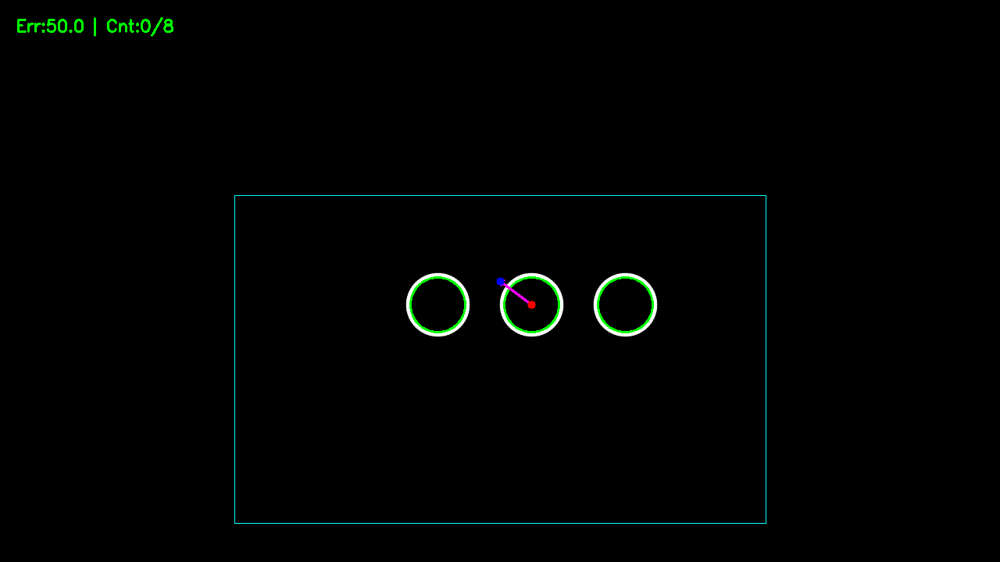

# Charging-port alignment with OpenCV

A camera facing a charging socket has to locate the port group even when it sits off center. This Python module looks for three roughly horizontal circles, estimates their center, and converts its displacement from the image center into a serial adjustment command. The repository includes an offline example that runs the detector on generated images.



The cyan rectangle marks the search area. The green outlines show the selected circles. Their center is the red dot, and the arrow points to the blue image center. In this example the group is 40 pixels to the right and 30 pixels below center.

## Run the offline example

From this directory, run the following in Windows PowerShell. The pinned versions were tested with Python 3.12.14 on Windows.

```powershell
py -3.12 -m venv .venv
.\.venv\Scripts\python.exe -m pip install -r requirements.txt
.\.venv\Scripts\python.exe offline_demo.py
```

The example generates all frames in memory, uses OpenCV's Hough transform, and writes serial messages to a memory buffer. With the supplied configuration, a two-circle frame leaves the alignment counter at zero. The off-center frame produces one adjustment, and the eighth consecutive centered frame completes alignment. The captured messages are

```text
A:-1.732,-1.299
M:37
```

To save the annotated off-center frame, run `offline_demo.py --output preview.png` with the same Python interpreter.

## Source files

| File | Role |
| --- | --- |
| [vision_system.py](vision_system.py) | Reads camera index 0, requests 1280 × 720, detects the port group inside a configured region, and sends adjustment and insertion requests. |
| [calibration_tool.py](calibration_tool.py) | Provides sliders for circle detection and estimates centimeters per pixel from the known distance between the outer two circle centers. |
| [vision_config.json](vision_config.json) | Stores the historical calibration scale of 0.04329 cm/pixel, a 4.0 cm reference width, ROI margins, Hough settings, and alignment thresholds. |
| [alternative/test.py](alternative/test.py) | Standalone full-frame detector with a fixed example scale of 0.02 cm/pixel. This file opens camera and serial devices when run directly. It sends adjustments only. |

The main detector converts the cropped image to grayscale, applies a median filter, and detects candidate circles. It keeps circles within 15 pixels of the median vertical coordinate, sorts them from left to right, and takes the middle three. The selection assumes roughly horizontal ports. If another set of three circles matches that geometry, the detector has no appearance model to distinguish it.

The supplied control settings require eight consecutive detections within a 20-pixel radius of the image center. A larger error or a missed detection resets the counter. Adjustment uses a separate per-axis deadband of 10 pixels and a minimum interval of 100 ms. Both axes are inverted in the saved configuration. A successful serial write records an outgoing request. The vision script receives no motion or insertion acknowledgement.

## Original camera and controller workflow

1. Use a compatible camera and check that the requested resolution and ROI contain the port group. Measure the outer-to-outer center spacing for the actual fixture and enter it as `real_width_cm` in the JSON.
2. Run `calibration_tool.py` from a graphical desktop with the same Python interpreter. Tune the four Hough sliders until the correct three circles are highlighted. With a current valid detection and at least six collected measurements, press **Space** to save the thresholds and scale. **Q** exits. The tool writes to the JSON beside the script.
3. For a physical run, review the serial endpoint and axis directions against the controller. Running `vision_system.py` opens `COM5` at 9600 baud by default. It can send `A:<dx_cm>,<dy_cm>` while acquiring the target and `M:37` on alignment. Both messages end in a newline. The standalone `alternative/test.py` uses the same port and baud rate, processes the whole frame, and sends an adjustment for each qualifying detection.

The camera, receiver firmware, mechanism, and physical alignment accuracy were outside the offline check. The saved scale describes a particular camera setup and needs recalibration if the viewing geometry changes.

## What was verified

The offline run exercised the original frame-processing function on synthetic images. A separate check supplied simulated camera and serial devices to the live entry point and verified the adjustment, completion message, and device cleanup. Losing one of three circles cleared a partially accumulated alignment count. For an offset of (+40, +30) pixels, the standalone detector produced `A:-0.800,-0.600` with its fixed example scale.

During repository preparation, the calibration distance calculation was changed to convert coordinates to signed Python integers before subtraction and to use `numpy.hypot`. On NumPy 2.3.5, the original unsigned calculation reported 156.4 pixels for an outer-center span of 300 pixels. The corrected calculation returned 240, 300, and 320 pixels for generated targets with those spans. The archived configuration values were preserved. The offline demo, preview, and dependency pins were added during preparation.
