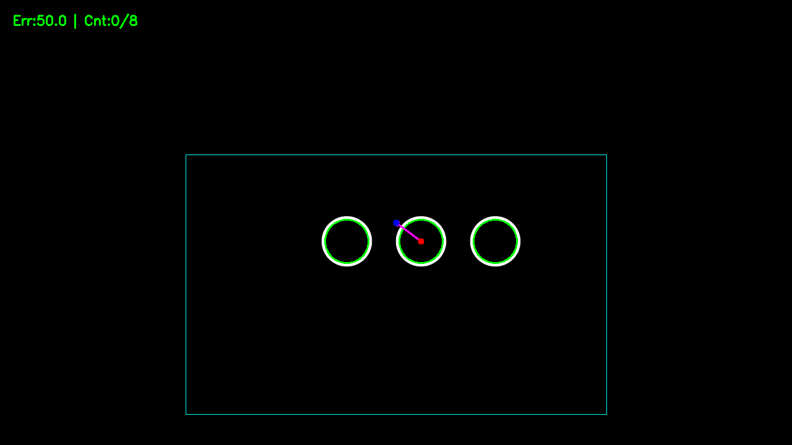

# Vision-Based Alignment for a Robotic Charging System

## Project Overview

This project explores a camera-based approach to aligning a robotic charging
system with a charging socket.

The vision system identifies circular features on the charging interface and
estimates their position relative to the image center. The estimated offset can
then be used to support robot alignment before insertion.

## My Contributions

- Contributed to the mechanical interface and end-effector platform.
- Participated in prototype assembly and system debugging.
- Applied image processing to detect features of the charging socket.
- Calculated visual offsets to support alignment.
- Tested the vision system under different lighting conditions.
- Supported end-effector calibration and alignment verification.

## Technologies

- Python
- OpenCV
- Computer vision
- Robotic alignment
- Calibration and testing

## How It Works

1. Capture an image of the charging interface.
2. Detect the circular features of the socket.
3. Estimate the position of the feature group.
4. Calculate its offset from the image center.
5. Use the detection result to support the alignment process.

## Demonstration

The image below shows a detection example using a **synthetic image**.

In the visualization:

- Green circles indicate the detected features.
- The red dot marks the estimated center of the feature group.
- The blue dot marks the image center.
- The arrow shows the direction between the two centers.

## Project Note

This page is intended to provide an overview of the project and my
contributions. The source code and certain project materials are not publicly
available.