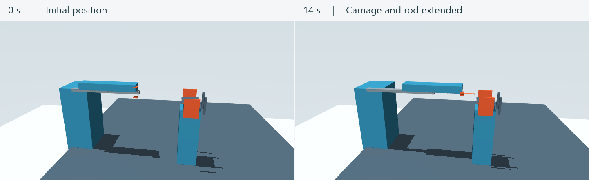

# MuJoCo battery-handling fixture

This scene comes from the early robotic-arm handling phase of a team project on embodied intelligence for humanoid factory material handling. The archived scene places a six-axis arm and a five-finger hand next to a drone, a loose battery and a bench fixture. Its Python client sends timed position setpoints for the arm, the twenty finger actuators and the six fixture actuators. In the fixture sequence, two pairs of jaws move, a carriage advances and a push rod extends.



The two frames come from the self-contained fixture model supplied here. The blue supports and grey rail replace CAD visuals. The orange parts show the jaws and push rod.

## Run the fixture

Open Windows PowerShell in the directory containing `simulate.py`. The headless run should print `Played 225 commands over 31.000 simulated seconds with 6 actuators.`

```powershell
python -m venv .venv
.\.venv\Scripts\python.exe -m pip install mujoco==3.3.7
.\.venv\Scripts\python.exe simulate.py --headless
```

Run `.\.venv\Scripts\python.exe simulate.py` to watch the same motion in the desktop viewer. On Linux, use `.venv/bin/python` in place of the Windows environment executable. The checks below used Windows and Python 3.12.

## What came from the archive

| File | Contents and provenance |
| --- | --- |
| [sequence.json](sequence.json) | Initial targets, start and end setpoints, interpolation counts and pauses transcribed from the active instructions in the archived `udpClient.py`. The complete sequence has 21 phases. Five of them operate the bench fixture. |
| [fixture.xml](fixture.xml) | Review model assembled from the table body, six sliding joints, primitive collision geometry and matching position actuators in `main.xml` and `mjcf/fr3/fr3_control.xml`. It includes simplified visual supports. The arm, hand, drone and loose battery are available in the full local scene. |
| [replay.py](replay.py) | Review implementation of the archived interpolation and timing. It can also send the selected setpoints to the viewer on the same machine. |
| [simulate.py](simulate.py) | Review launcher. By default it steps the fixture using the five fixture phases. It can also run the full archived scene or receive JSON setpoints over loopback UDP. |

The full model uses MJCF includes and external meshes and textures. Its scene directories identify RoboHive assets and acknowledge the ROBEL scenes. The archive also contains a DexRobot logo. Those visual assets remain in the original archive. The fixture preview uses primitive geometry throughout.

## Full scene for archive holders

1. In `final-mujoco.zip`, open the `final-mujoco` folder. Extract `main.xml`, `mjcf/`, `meshes/` and `textures/` into one local directory. Keep their relative paths. Use the new Python environment above.
2. On a case-sensitive filesystem, rename `meshes/fr3_scene/battery_link_0.stl` to `battery_link_0.STL` to match the active XML reference.
3. Pass the path to the extracted `main.xml` in the following command. Replace the example path with your own. Remove `--headless` to open the viewer.

```powershell
.\.venv\Scripts\python.exe simulate.py --headless --model "C:\models\final-mujoco\main.xml"
```

Use `main.xml` as the entry point. The cached `mjmodel.xml` uses older actuator names for the two slides. The archived `main.py` starts a viewer and UDP listener, and `udpClient.py` supplies the recorded motion. The review launcher keeps all MuJoCo state updates in the simulation loop. Its optional listener accepts JSON on `127.0.0.1:12345`.

## Replay through UDP

In one PowerShell window, start the listener. In a second window, open the same `simulation` folder and start the client.

```powershell
# First window
.\.venv\Scripts\python.exe simulate.py --listen

# Second window
.\.venv\Scripts\python.exe replay.py
```

For the archived scene, add `--model "C:\models\final-mujoco\main.xml"` to the listener and `--full` to the client. The default in-process run applies every command directly. UDP playback follows wall-clock timing and has no acknowledgement mechanism.

## Verification

| Check | Observed result |
| --- | --- |
| Fixture with MuJoCo 3.3.7 | 225 commands, 31 simulated seconds and 6 actuators. The rendered frames above show the initial pose and the state at 14 seconds. |
| Archived full scene with MuJoCo 3.3.7 | 6 XML files and 205 unique external mesh or texture files resolved. The model loaded 32 actuators. The full replay applied 2,092 commands over 244 simulated seconds. Final joint positions were finite and MuJoCo reported zero simulation warnings. |
| Sequence comparison | All 2,092 setpoint dictionaries and their requested delays matched an offline recording of the archived client. The headless replay maps those delays to simulation time. The original client sent UDP packets on a wall clock while the viewer stepped the model separately. |
| Loopback receiver | A local UDP datagram updated the requested push-rod control value in the fixture. |

These checks cover model loading, replay and one UDP control update. They do not measure successful battery transfer. The project’s midterm report presents full-body humanoid handling, PPO training, perception fusion and a 95% success target as later objectives. The playback results above cover the scripted arm and fixture stage only.
